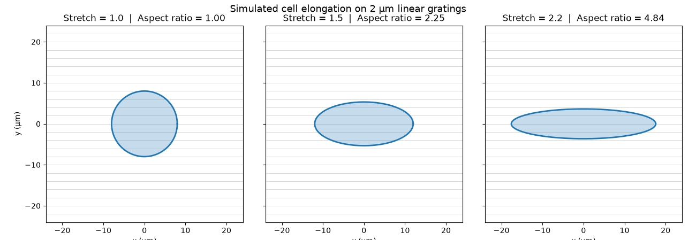

# Vascular-Graft-FSI-Framework

This is a learning-oriented pipeline for studying how micro-topographical surface cues  and pulsatile hemodynamics affect cells on a tissue-engineered vascular graft. It connects CAD design, confocal image analysis, data processing, Fluid-Structure Interaction (FSI) simulation, and probabilistic modelling.

> **Project status: active learning project.**
> The CAD design, image analysis, and Python morphometrics modules are the current working foundation. The **COMSOL/MATLAB FSI simulations and the Bayesian Network optimization are under active development** as part of my ongoing learning track. They are documented here as the intended architecture and are not yet validated. No results in this repository should be read as validated physiological predictions.

---

## Motivation

Small-diameter vascular grafts (<6 mm) have poor long-term patency, partly because of thrombosis and a mismatch between graft and native-vessel mechanics. Two levers are explored here:

1. **Surface topography:** linear gratings (2 µm scale) can guide endothelial cell alignment and elongation.
2. **Mechanical environment:** pulsatile flow imposes wall shear stress and cyclic strain, which influence cell survival and phenotype.

The goal is a connected workflow in which geometry, experimental imaging, and simulation inform each other.

---

## Pipeline Overview

```
 ┌────────────┐     ┌──────────────┐     ┌──────────────┐
 │ SolidWorks │     │ Fiji/ImageJ  │     │    Python    │
 │ 3D design  │     │ segmentation │ ──► │ data cleaning│
 │            │     │ & tracking   │     │ & morphometry│
 └─────┬──────┘     └──────────────┘     └──────┬───────┘
       │                                         │ (cell metrics for
       │ geometry                                │  comparison/validation)
       ▼                                         ▼
 ┌─────────────────────────────┐          ┌──────────────┐
 │ COMSOL Multiphysics + MATLAB│  ──────► │     geNIe    │
 │ FSI: Navier-Stokes + PVA    │  shear   │   Bayesian   │
 │ hyperelastic wall           │  stress/ │   Network    │
 │ (IN DEVELOPMENT)            │  strain  │(IN DEVELOPMENT)
 └─────────────────────────────┘          └──────────────┘
```

| Stage | Tool | Role | Status |
|---|---|---|---|
| 1 | SolidWorks | Parametric 3D design | Working foundation |
| 2 | Fiji (ImageJ) | Segmentation and boundary tracking | Working foundation |
| 3 | Python | Coordinate cleaning and morphometrics | In progress |
| 4 | COMSOL + MATLAB | FSI simulation and parameter automation | Under active development |
| 5 | geNIe | Bayesian cell-survival prediction | Planned |

---

## Module Breakdown

### 1. SolidWorks: Parametric Design
- **4 mm inner-diameter hollow vascular graft**, modelled parametrically so wall thickness and length can be varied.
- **2 µm internal linear topographical gratings** on the luminal surface, designed to guide cell alignment.
- **Custom pulsatile bioreactor chamber housings** to hold the graft and connect to a flow loop.
- *Output:* CAD geometry (STEP/Parasolid) for import into COMSOL.

### 2. Fiji (ImageJ): Image Segmentation and Boundary Tracking
- Processes **live-cell confocal microscopy** datasets.
- Segments individual cells (thresholding, filtering, watershed or equivalent) and tracks cell boundaries across frames.
- *Output:* coordinate matrices of cell boundaries, exported as CSV.

### 3. Python: Data Bridge and Morphometrics
- Cleans the exported Fiji coordinate matrices (missing values, duplicates, outliers).
- Calculates **morphometric descriptors**, chiefly the **cell aspect ratio** (major axis / minor axis), as a quantitative readout of elongation and alignment on the gratings.
- Libraries: `numpy`, `pandas`, `matplotlib`.
- *Included example:* `scripts/cell_stretch_demo.py` is a simple 2D model of a cell boundary stretching over a 2 µm grating background.
- 


### 4. COMSOL Multiphysics + MATLAB: FSI Engine *(under active development)*
- **Intended core engine** of the framework.
- Planned physics:
  - **Fluid:** laminar, incompressible **Navier-Stokes** blood flow (initially Newtonian, with non-Newtonian models as a later extension).
  - **Solid:** **hyperelastic PVA-hydrogel** graft wall (candidate models: Neo-Hookean, Mooney-Rivlin).
  - **Coupling:** two-way FSI with a pulsatile inlet waveform.
- **MATLAB (LiveLink)** will automate parameter sweeps (flow rate, wall stiffness, grating geometry).
- *Planned output:* wall shear stress and strain datasets.
- *Current focus:* mastering the COMSOL workflow through benchmark problems (e.g., Poiseuille flow, simple FSI tutorials) before moving to the full graft model.

### 5. geNIe: Bayesian Network Optimization *(planned)*
- Build **Bayesian Networks** that link mechanical inputs (shear stress, strain) and surface topography to **cell survival** outcomes.
- Run probabilistic optimization to identify favourable design and operating conditions.
- *Input:* shear stress and strain datasets from the FSI stage, plus morphometrics from the experimental stage.

---

## Repository Structure

Folders marked *(planned)* are placeholders for work still to come.

```
Vascular-Graft-FSI-Framework/
├── README.md
├── cad/                  # SolidWorks parts and exported STEP files
├── imaging/              # Fiji macros and example data
├── scripts/
│   └── cell_stretch_demo.py
├── fsi/                  # COMSOL models + MATLAB scripts (planned)
├── bayesian/             # geNIe network files (planned)
├── docs/                 # Notes, references, figures
└── requirements.txt
```

---

## Getting Started

```bash
git clone https://github.com/ashakeabayomi/Vascular-Graft-FSI-Framework.git
cd Vascular-Graft-FSI-Framework
pip install -r requirements.txt
python scripts/cell_stretch_demo.py
```

**`requirements.txt`**
```
numpy
matplotlib
```

**Software used:** SolidWorks, Fiji (ImageJ), Python 3.9+, COMSOL Multiphysics with MATLAB LiveLink, geNIe. Commercial packages require their own licences.

---

## Roadmap

- [x] Define pipeline architecture
- [x] Parametric graft and grating design in SolidWorks
- [ ] Standardise Fiji segmentation macro
- [ ] Python pipeline for cleaning Fiji CSV output and computing aspect ratios
- [ ] COMSOL benchmark: laminar flow in a rigid tube
- [ ] COMSOL benchmark: hyperelastic wall under pressure
- [ ] Full 2-way FSI with pulsatile inlet
- [ ] MATLAB-automated parameter sweeps
- [ ] Bayesian Network for cell survival in geNIe
- [ ] Validate simulation against experimental data

---

## Limitations and Disclaimer

- This is a **personal learning project**, not a validated research tool.
- The FSI and Bayesian modules are **not yet complete**; model assumptions, material parameters, and boundary conditions still need verification against the literature and experiments.
- The Python demo is a **conceptual visualisation**, not a biophysical model.

---

## Author

**Peace Nifemi Abayomi** | Biomedical Engineering Graduate

Research interests: computational tissue engineering, vascular biomechanics, FSI modelling

Contact: ashakeabayomi@gmail.com | [linkedin.com/in/peaceabayomi](#) 

